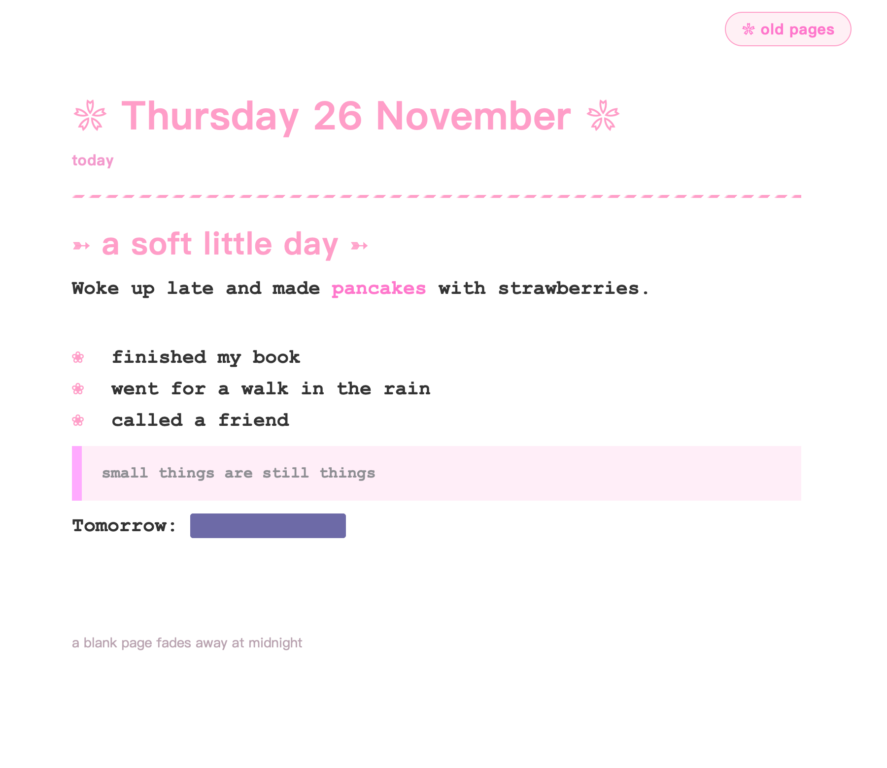

# ❀ Fairy Journal ❀

A small, cute journal app for Mac with a soft pink theme.



## What it does

- Opens on **today's page**, with the date at the top.
- You just write. Every change saves as you go.
- **Blank days don't stay.** A page is only kept once you've
  written something on it. If you write nothing that day, the
  page is gone at midnight.
- **Old pages** live in a folder, grouped by month and then by
  week. Each day shows its first line.
- Mac spell check and autocorrect are on (switch them under
  Edit → Spelling and Grammar).

## Writing shortcuts

| Type this              | You get               |
| ---------------------- | --------------------- |
| `# ` at line start     | ❀ big heading ❀       |
| `## `, `### `, `#### ` | ➳ / ♥ / ♪ headings    |
| `- ` or `* `           | flower bullet list    |
| `1. `                  | numbered list         |
| `> `                   | pink quote box        |
| `---` then Enter       | striped pink line     |
| ⌘B / ⌘I                | bold pink / italic    |
| ⌘⇧X                    | secret ink: hidden until you point at it |

## Where pages are saved

One file per day in `~/Documents/Journal`, for example
`2026-11-26.html`. They're plain files on your own Mac.

## Build it

You need macOS 12 or newer and the Xcode command line tools
(`xcode-select --install`).

```sh
./build.sh
```

This builds `Fairy Journal.app` and puts it in `~/Applications`.

## Thanks

The look is based on the Typora theme
[PinkFairy](https://github.com/ShimuGuyue/typora-theme-PinkFairy)
by ShimuGuyue, MIT licence (see `web/PINKFAIRY-LICENSE.txt`).
